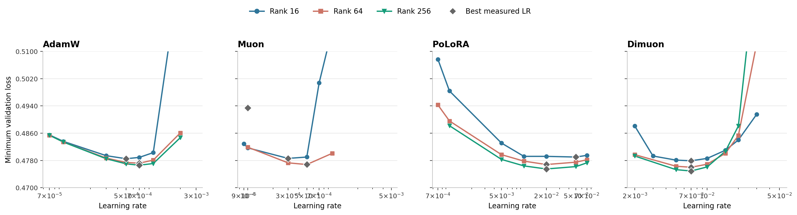

---
keywords:
  - LoRA
  - PEFT
  - optimizer
  - Muon
  - Dimuon
  - PoLoRA
  - fine-tuning
comments: true
title: "Do LoRA Optimizers Matter? Testing Muon, PoLoRA and Dimuon for PEFT"
---

In October, Thinking Machines added [Dimuon](https://tinker-docs.thinkingmachines.ai/tinker/optimizers/) to Tinker, an optimizer built specifically for LoRA. A few months earlier [PoLoRA](https://arxiv.org/abs/2607.17620) (Ghosh, Parshakova and Gower) proposed a preconditioned, orthogonalized optimizer for LoRA factors, and before that there were [LoRA-RITE](https://arxiv.org/abs/2410.20625), [LoRA+](https://arxiv.org/abs/2402.12354) and [Riemannion](https://arxiv.org/abs/2507.12142). The pitch is always similar: a LoRA adapter is a product $$BA$$, not two independent matrices, so an optimizer that treats A and B as flat parameter vectors (AdamW) or as two unrelated matrices (Muon) is leaving something on the table.

I wanted to know two things. Does a LoRA-specific optimizer actually beat a tuned AdamW? And if it does, which part of the algorithm is responsible? So I spent about three weeks and ~170 runs on Qwen3-1.7B finding out. The short version: they help a little, the help grows with rank, and most of what makes these optimizers look different from each other doesn't matter.

## It looked like a landslide at first

My first pilot was rank 16, 50 steps, one shared learning rate for every Muon-style variant and the usual 2e-4 for AdamW:

| optimizer | lr | eval loss |
|---|---|---|
| AdamW | 2e-4 | 0.5730 |
| Muon | 2e-3 | 0.5592 |
| Muon + partner whitening | 2e-3 | 0.5307 |
| Muon + tangent projection | 2e-3 | 0.5395 |

A 0.04 gap in favour of the "coupled" variants. That gap turned out to be more than 20 times larger than any difference I could find once every optimizer had its own learning rate sweep. Keep that in mind when you read optimizer tables, including mine.

## Setup

| item | value |
|---|---|
| Model | Qwen3-1.7B, bf16 base, fp32 adapters |
| Data | OpenThoughts-114k, reformatted to Qwen chat with `<think>` tags; 16,000 train / 1,000 held-out eval, max length 4096 |
| LoRA | all 7 projections (196 A/B pairs), alpha fixed at 32, dropout 0.05 |
| Batch | 4 × 4 accumulation = 16 sequences |
| Schedule | 1,000 steps (one epoch), cosine with 30 warmup steps |
| Metric | held-out eval loss, single seed (42) |

Because everything is single-seed, I measured the noise floor first: the same Dimuon config with seed 42 vs 43 differed by at most 1e-4 across every eval from step 100 to 1000, and re-running an identical config gave about 2e-4 of GPU nondeterminism at step 50. So my rule throughout: **differences below ~3e-4 are not interpretable, differences above 1e-3 are solid.**

The four optimizers, briefly:

- **AdamW**: elementwise adaptive moments, treats A and B as flat vectors.
- **Muon**: momentum, then replace each matrix's update with its polar factor (all singular values set to 1, via Newton–Schulz), scaled by $$0.2\sqrt{\max(m,n)}$$ to match AdamW's update RMS. Applied to A and B independently.
- **PoLoRA**: diagonal curvature preconditioning on each factor (an EMA of squared gradients), whitening by the partner factor's Gram matrix so A and B are coupled, a polar step, and a step size of $$\text{lr}/(\sigma_A+\sigma_B)$$ that bounds both the factor updates and the change in $$BA$$.
- **Dimuon**: Tinker's public docs only expose `learning_rate`, `beta1` (default 0.9) and gradient clipping. The implementation I trained with scales each factor's momentum by diagonal conditioners built from momentum "energy", on both the feature axis (input features for A, output features for B) and the rank axis, takes a polar step, and uses a fixed-size Frobenius step with a rank constant $$(r/32)^{0.175}$$.

## Step one: tune the learning rate for every optimizer, at every rank

{: .align-center}

*Minimum eval loss over each 1,000-step run, by learning rate. Grey diamonds mark the best learning rate per rank. The lone Muon rank-256 point is a single run that was stopped at step 300, not a sweep.*

Best result per optimizer and rank:

| optimizer | rank 16 | rank 64 | rank 256 |
|---|---|---|---|
| AdamW | 0.4785 (lr 5e-4) | 0.4772 (7e-4) | 0.4766 (7e-4) |
| Muon | 0.4786 (3e-4) | 0.4768 (5e-4) | incomplete |
| PoLoRA | 0.4790 (0.05) | 0.4768 (0.02) | 0.4755 (0.02) |
| **Dimuon** | **0.4779** (7e-3) | **0.4760** (7e-3) | **0.4749** (7e-3) |

A few things fall out of this:

**Dimuon wins at every rank, and the lead grows with rank.** Against tuned AdamW it is 6e-4 ahead at rank 16 (borderline), 1.2e-3 at rank 64 and 1.7e-3 at rank 256. PoLoRA follows the same trend from the other side: 5e-4 *behind* AdamW at rank 16, 1.1e-3 ahead at rank 256. Whatever these optimizers do, it is worth more when the adapter has more directions to use.

**Muon gives nothing over AdamW for LoRA at rank 16** (0.4786 vs 0.4785), and a borderline 4e-4 at rank 64.

**Dimuon's best learning rate didn't move across ranks.** It is 7e-3 at 16, 64 and 256. PoLoRA's is 0.02 at 64 and 256 (and rank 16 is flat from 0.01 to 0.05). AdamW and Muon shift with rank. For anyone sweeping ranks, a learning rate you don't have to re-tune is a real practical win.

**The Dimuon-to-AdamW learning rate ratio is 10–14×**, which lines up with Tinker's guidance of "about 15× the AdamW learning rate" for SFT. If you take an AdamW LoRA recipe and switch optimizers, multiplying the lr by ~10–15 is a good first guess.

**Rank 16 is the fragile one for AdamW and Muon.** At lr 1e-3 AdamW is already 3e-3 worse at rank 16 than at rank 256, and it diverges at 3e-3. Muon at rank 16 falls off a cliff from 7e-4 (0.501), while rank 64 is still fine at 1e-3 (0.480). Part of this is just parametrization: alpha is fixed at 32, so the LoRA multiplier $$\alpha/r$$ is 2 at rank 16 and 0.125 at rank 256, and the same lr means a much bigger effective update at low rank. Dimuon goes the other way: at too-high lr its rank-256 curve blows up first, which is at least consistent with its step growing with rank through the $$(r/32)^{0.175}$$ constant.

Now the honest framing: the whole spread is 1.7e-3 of cross-entropy, about 0.2% in perplexity. Rank alone moved AdamW by 1.9e-3 and Dimuon by 3e-3. These optimizers are not going to rescue a bad data mix.

## Step two: what is Dimuon actually doing?

To answer "which part matters", I wrote one optimizer (`UnifiedLoRA`) with a switch for every design axis, and checked that its presets reproduce the originals: Dimuon bit-identical, Muon and PoLoRA within 5e-6 relative over six steps. The axes:

- **feature-side statistic**: none, momentum energy (Dimuon), squared-gradient EMA (PoLoRA), or activation second moments (the K-FAC input metric)
- **rank-side / coupling**: none, energy, or the partner factor's Gram (PoLoRA)
- **polar**: Muon's 5-step bf16 Newton–Schulz, exact SVD, a cutoff that drops weak directions
- **step rule**: Muon RMS matching, spectral, $$\text{lr}/(\sigma_A+\sigma_B)$$, a fixed rank constant, Frobenius

Then I swapped one component at a time at rank 16. For pruning I stopped runs at step 500 but kept the 1,000-step cosine schedule, so step-500 numbers are directly comparable to a full run's step 500.

### Feature-side conditioning is the active ingredient

Take plain Muon, add *only* Dimuon's feature-side conditioners, and hold the update norm at Muon's own so only the direction changes. At step 500:

| config | step 500 |
|---|---|
| Muon | 0.4833 |
| Muon + Dimuon's conditioners | 0.4818 |
| Dimuon | 0.4817 |

That reproduces Dimuon to 1e-4 without Dimuon's step rule, momentum or rank-side conditioning. The mirror test agrees: replacing Dimuon's conditioners with the identity costs +0.003 at steps 100–300.

### Which statistic you condition with doesn't matter

| frame | momentum energy | squared-gradient EMA |
|---|---|---|
| Dimuon | 0.4817 | 0.4820 |
| PoLoRA | 0.4813 (lr 5e-3) | 0.4819 (lr 0.02) |

Both within 3e-4 at their own learning rates. I also tried conditioning A by activation second moments, the textbook [K-FAC](https://arxiv.org/abs/1503.05671) input metric, which is exact from the first step instead of being a noisy momentum estimate. It tied: 0.48160 vs Dimuon's 0.48168 at step 500.

### Conditioning buys speed, not final quality

This is the most important caveat in the whole study. "Muon + Dimuon's conditioners" was 1.5e-3 ahead of Muon at step 500, roughly 15× the noise floor. At step 1000 it was 1.2e-4 ahead (0.47845 vs 0.47857), which is noise. Under a one-epoch cosine schedule, the decay does the work at the end; the geometry decides how fast you get there.

Conditioning also has an up-front cost. At step 50, with the update norm held fixed, conditioned runs are 0.025 (Dimuon's step) to 0.052 (Muon's step) *worse*, and the cost is gone by step 100. It isn't an estimation problem either: the clean activation statistic had a bigger step-50 cost (+0.038) than the noisy momentum one (+0.025).

So at rank 16 the story is clean: conditioning gets you there faster, and the schedule catches everyone else up. What that doesn't explain is why Dimuon's *final* lead grows with rank. All of these ablations ran at rank 16, where the final gaps are tiny; I haven't isolated what carries the rank-256 lead. My best guess is Dimuon's fixed-size Frobenius step, but that's a guess.

### Things that turned out not to matter

I had a list of hypotheses about why one optimizer beats another. Most of them died.

**Muon's width scaling.** Muon multiplies each update by $$0.2\sqrt{\max(m,n)}$$, which for a LoRA factor means scaling by the *model's* width, not the rank. Seems wrong for a 16-row matrix. But removing it tracks Muon within 4e-4 at rank 64 and recovers none of Dimuon's 3.5e-3 lead at step 500.

**Polar accuracy and weak directions.** This one was a real phenomenon with no consequence. The momentum's stable rank is about 3 *at every adapter rank*, so as rank grows most directions are weak: 5.5% of directions are below 0.1·σ_max at rank 16, 40% at rank 64, 84% at rank 256. I checked with a split-half probe that these directions are noise (two disjoint data halves agree on almost nothing there). A polar step blows them up to the same size as the strong ones, which sounds bad. But dropping them changed step-500 loss by ≤2e-4, and an exact SVD polar vs Muon's 5-step bf16 approximation differed by ≤3e-4.

**PoLoRA's A/B coupling.** Adding it to Dimuon changed the result by 3e-5. The reason is that B's Gram matrix, which PoLoRA uses to whiten A's update, is well conditioned (condition number ~1.4), so whitening by its inverse square root is within 5% of multiplying by a scalar, and the step-size normalization cancels scalars anyway. Coupling would matter for strongly anisotropic factors; a B that starts at zero isn't one.

**PoLoRA's adaptive step size.** $$1/(\sigma_A+\sigma_B)$$ starts at 1.6 and decays to 0.66 over training, with a geometric mean of about 1.03. Dimuon's rank constant is also about 1 near the reference rank. Swapping one for the other: +1.8e-4 at rank 16, −1.4e-4 at rank 64. Same scale, two fewer power iterations per pair.

**PoLoRA's "double annealing".** Self-annealing step size plus cosine schedule sounded like it might decay too hard late in training. Removing either decay made things worse (removing σ: +5e-4; removing cosine: +1.9e-3).

**Gradient clipping.** Dimuon's gradient norm is ~0.09 after step 1, so a clip at 1.0 only touches the first step. Tinker's docs also say to leave it off.

**The 0.175 exponent.** At a fixed rank $$(r/32)^{0.175}$$ is just a constant multiplier on the lr, so no single-rank experiment can test it. Across ranks it changes the step by 1.6× from rank 16 to 256, while the lr plateau is about ±2× wide. My data are consistent with the exponent doing nothing and with it doing exactly the right thing.

## Learning rate and schedule swamp everything else

Every architectural difference I measured was ≤2e-3. Within a sensible range the learning rate moved results by up to 5e-3, and missing the optimum by 4–10× moved them by 1e-2 or more:

| same config, different lr | step 500 |
|---|---|
| PoLoRA + energy, lr 5e-3 vs 0.02 | 0.4813 vs 0.4862 |
| Dimuon + PoLoRA step, lr 5e-3 vs 0.05 | 0.4815 vs 0.5062 |
| rank-constant step, rank 64, lr 5e-3 vs 0.02 | 0.4805 vs 0.4905 |

Two of my early hybrids looked like failures purely because I ran them at the wrong lr, and the best lr for "PoLoRA + energy statistic" was 4× away from PoLoRA's own. Changing *one* component of an optimizer can move its optimal lr.

The schedule is the other big lever. Dimuon with a constant lr finished at 0.4815 vs 0.4781 with cosine, a 3.4e-3 gap, twice the size of Dimuon's best-case lead over AdamW.

**An optimizer compared at an untuned learning rate is not being compared at all.** That pilot table at the top of this post is exactly this mistake.

## What I'd actually do

1. **Tune the lr and use a decaying schedule before you touch the optimizer.** That's 3–5e-3 of loss on the table vs ≤2e-3 for the optimizer.
2. **If you can switch, Dimuon is a reasonable default for LoRA SFT**, especially at rank ≥64. Start at 10–15× your AdamW lr (7e-3 vs 5–7e-4 here). The bonus is that its best lr stayed put across ranks.
3. **Don't bother with plain Muon for LoRA** at low rank. It matched AdamW, nothing more.
4. **If you're building your own**, the part that matters is diagonal conditioning on the feature side of each factor. The statistic can be whatever is cheapest. The simplest version I tested (energy conditioning, polar, a fixed rank-based step, one state buffer, no power iterations) tied Dimuon and PoLoRA at step 500 at both rank 16 (0.4815) and rank 64 (0.4805).
5. **Don't spend runs on** polar step counts, weak-direction cutoffs, A/B coupling, gradient clipping or the rank exponent.

## Caveats

- **One model, one dataset, one epoch, one seed per config.** I measured the seed spread (≤1e-4) but not seed × config interactions.
- **Mid-run is not final.** "PoLoRA + energy" had the best step-500 number of anything (0.4813) and finished 3e-4 behind Dimuon at the same lr. Truncated runs are for pruning, not conclusions.
- **Eval loss only.** No downstream benchmarks; at these gaps I'd expect them to be within noise.
- **No wall-clock comparison.** The runs shared GPUs with other jobs and step times varied from 18 to 30 seconds, so timing numbers would be meaningless.
- **Alpha was fixed at 32 across ranks**, which tangles rank with the LoRA multiplier for AdamW and Muon.

## Open questions

- **Does the conditioning advantage survive at a fixed, non-converged token budget?** If you stop at 200 steps without decay, or train for three epochs, "conditioning = speed" should either become a real final-quality gap or disappear. That's the experiment that would make the claim defensible.
- **Why does Dimuon's final lead grow with rank** when its conditioning advantage is transient at rank 16? The fixed-size Frobenius step is the main suspect.
- **Which factor carries the effect?** Two weak leads point at B: shifting lr from A to B lands within 5e-5 of removing the conditioners at step 50, and B's statistic is the only one that separates the curves in the A-vs-B statistic ablation. Conditioning only A or only B for 200 steps would settle it cheaply.

LoRA-specific optimizers are real but modest. Most of the gap you see in papers and announcements disappears when the baseline gets its own lr sweep and a schedule. What's left is a feature-side diagonal conditioner that makes training faster early and, at higher ranks, finishes a little better.

## References

[1] Thinking Machines. "Optimizers." *Tinker documentation* (2026). https://tinker-docs.thinkingmachines.ai/tinker/optimizers/

[2] Ghosh, N., Parshakova, T., Gower, R. M. "PoLoRA: A Preconditioned Orthogonalized LoRA Optimizer." *arXiv:2607.17620* (2026). https://arxiv.org/abs/2607.17620

[3] Jordan, K. "Muon: An optimizer for hidden layers in neural networks." (2024). https://kellerjordan.github.io/posts/muon/

[4] Martens, J., Grosse, R. "Optimizing Neural Networks with Kronecker-factored Approximate Curvature." *ICML* (2015). https://arxiv.org/abs/1503.05671

[5] Hayou, S., Ghosh, N., Yu, B. "LoRA+: Efficient Low Rank Adaptation of Large Models." *arXiv:2402.12354* (2024). https://arxiv.org/abs/2402.12354

[6] Yen, J.-N., Si, S., Meng, Z., et al. "LoRA Done RITE: Robust Invariant Transformation Equilibration for LoRA Optimization." *arXiv:2410.20625* (2024). https://arxiv.org/abs/2410.20625

[7] Bogachev, V., Aletov, V., Molozhavenko, A., et al. "LoRA meets Riemannion: Muon Optimizer for Parametrization-independent Low-Rank Adapters." *arXiv:2507.12142* (2025). https://arxiv.org/abs/2507.12142

[8] OpenThoughts team. "OpenThoughts-114k." https://huggingface.co/datasets/open-thoughts/OpenThoughts-114k
