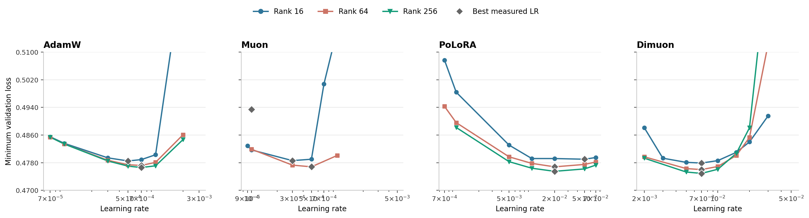

---
keywords:
  - LoRA
  - PEFT
  - optimizer
  - Muon
  - Dimuon
  - PoLoRA
  - fine-tuning
  - thinking machine
comments: true
header:
  image: better_optimizer_cover.PNG
  teaser: better_optimizer_cover.PNG
title: "What is LoRA specialized Muon optimizer even mean?"
---

In October, Thinking Machines added [Dimuon](https://tinker-docs.thinkingmachines.ai/tinker/optimizers/) to Tinker, an optimizer built specifically for LoRA. They didn't share any details how the optimizer works other than good scaling curve across higher rank (against AdamW) and the name "Dimuon" hinting its a Muon variant. A few months earlier [PoLoRA](https://arxiv.org/abs/2607.17620) (Ghosh, Parshakova and Gower) proposed a preconditioned, orthogonalized optimizer for LoRA factors, and before that there were [LoRA-RITE](https://arxiv.org/abs/2410.20625), [LoRA+](https://arxiv.org/abs/2402.12354) and [Riemannion](https://arxiv.org/abs/2507.12142). The pitch is always similar: a LoRA adapter is a product $BA$, not two independent matrices, so an optimizer that treats A and B as flat parameter vectors (AdamW) or as two unrelated matrices (Muon) is leaving something on the table.

> So does a LoRA-specific optimizer actually beat a tuned Muon? (Note Dimuon was never compared against Muon) And if it does, which part of the algorithm is responsible? 

With a few 5090 on hand and limited time, I tried to replicate the similar study on the following setup:

## Setup

| item | value |
|---|---|
| Model | Qwen3-1.7B, bf16 base, fp32 adapters |
| Data | OpenThoughts-114k, reformatted to Qwen chat with `<think>` tags; 16,000 train / 1,000 held-out eval, max length 4096 |
| LoRA | fixed dropout 0.05, with rank scaling for 16, 64, 256 |
| Batch | 4 × 4 accumulation = 16 sequences |
| Schedule | 1,000 steps (one epoch), cosine with 30 warmup steps |
| Metric | held-out eval loss, single seed (42) => any differences below ~3e-4 are not interpretable, >= 1e-3 is solid run |

The four optimizers:

- **AdamW**: elementwise adaptive moments, treats A and B as flat vectors.

- **Muon**: Moonshot variant, with momentum scaled by $0.2\sqrt{\max(m,n)}$ to match AdamW's update RMS.

- **PoLoRA**: diagonal curvature preconditioning on each factor (an EMA of squared gradients), whitening by the partner factor's Gram matrix so A and B are coupled, a polar step, and a step size of $\text{lr}/(\sigma_A+\sigma_B)$ that bounds both the factor updates and the change in $BA$.

- **anpaure's Dimuon variant**: I rely on the reverse-engineered Dimuon implementation [dimuon.py](https://github.com/anpaure/dimuon/blob/main/dimuon.py) by [X:@anpaure](https://x.com/anpaure)

The first thing I notice compare to the PoLoRA design is the lack of A-B decomposition like what we see in PoLoRA $\sigma_A, \sigma_B$. Also in anpaure's Dimuon variant we rely on magic update size : $\sqrt{rank}x (rank / 32) ** 0.175$ fitted based on the gradient steps obtained comparing anpaure's Dimuon variant and adamw.

One sad thing is we have no explaination of what does the "Di" even refer to.

## Outcome based result, does anpaure's Dimuon variant actually works?

{: .align-center}

*Minimum eval loss over each 1,000-step run, by learning rate. Grey diamonds mark the best learning rate per rank. The lone Muon rank-256 point is a single run that was stopped at step 300, not a sweep.*

Best result per optimizer and rank:

| optimizer | rank 16 | rank 64 | rank 256 |
|---|---|---|---|
| AdamW | 0.4785 (lr 5e-4) | 0.4772 (7e-4) | 0.4766 (7e-4) |
| Muon | 0.4786 (3e-4) | 0.4768 (5e-4) | incomplete |
| PoLoRA | 0.4790 (0.05) | 0.4768 (0.02) | 0.4755 (0.02) |
| **Dimuon (anpaure)** | **0.4779** (7e-3) | **0.4760** (7e-3) | **0.4749** (7e-3) |

A few things fall out of this:

**anpaure's Dimuon variant wins at every rank, and the lead grows with rank.** Against tuned AdamW it is 6e-4 ahead at rank 16 (borderline), 1.2e-3 at rank 64 and 1.7e-3 at rank 256. PoLoRA follows the same trend from the other side: 5e-4 *behind* AdamW at rank 16, 1.1e-3 ahead at rank 256. Whatever these optimizers do, it is worth more when the adapter has more directions to use.

**Muon gives nothing over AdamW for LoRA at rank 16** (0.4786 vs 0.4785), and a borderline 4e-4 at rank 64.

If you're just here to see if you should swap optimizer, you can stop here and start using anpaure's Dimuon variant. 

Here's the integration of bitsandbytes I wrote with anpaure's Dimuon variant supported (QLoRA, FSDPv2) : [theblackcat102/bitsandbytes/tree/feature/muon](https://github.com/theblackcat102/bitsandbytes/tree/feature/muon)

## Step two: what is anpaure's Dimuon variant actually doing?

To answer "which part matters", I wrote one optimizer (`UnifiedLoRA`) with a switch for every design axis, and checked that its presets reproduce the originals: anpaure's Dimuon variant bit-identical, Muon and PoLoRA within 5e-6 relative over six steps. The axes:

- **feature-side statistic**: none, momentum energy (anpaure's Dimuon variant), squared-gradient EMA (PoLoRA), or activation second moments (the K-FAC input metric)
- **rank-side / coupling**: none, energy, or the partner factor's Gram (PoLoRA)
- **polar**: Muon's 5-step bf16 Newton–Schulz, exact SVD, a cutoff that drops weak directions
- **step rule**: Muon RMS matching, spectral, $$\text{lr}/(\sigma_A+\sigma_B)$$, a fixed rank constant, Frobenius

Due to resource constraint, all ablations are only done at rank 16. 

### Feature-side conditioning is the active ingredient

Take plain Muon, add *only* anpaure's Dimuon variant's feature-side conditioners, and hold the update norm at Muon's own so only the direction changes. At step 500:

| config | step 500 |
|---|---|
| Muon | 0.4833 |
| Muon + Dimuon (anpaure) conditioners | 0.4818 |
| Dimuon (anpaure) | 0.4817 |

That reproduces anpaure's Dimuon variant to 1e-4 without anpaure's Dimuon variant's step rule, momentum or rank-side conditioning. The mirror test agrees: replacing anpaure's Dimuon variant's conditioners with the identity costs +0.003 at steps 100–300.

### Which statistic you condition with doesn't matter

| frame | momentum energy | squared-gradient EMA |
|---|---|---|
| Dimuon (anpaure) | 0.4817 | 0.4820 |
| PoLoRA | 0.4813 (lr 5e-3) | 0.4819 (lr 0.02) |

Both within 3e-4 at their own learning rates. I also tried conditioning A by activation second moments, the textbook [K-FAC](https://arxiv.org/abs/1503.05671) input metric, which is exact from the first step instead of being a noisy momentum estimate. It tied: 0.48160 vs anpaure's Dimuon variant's 0.48168 at step 500.

### Conditioning converge faster initially but after annealing it doesn't matter much

As we scale the experiments even further, at step 1000 it was 1.2e-4 ahead (0.47845 vs 0.47857), which is noise. Under a one-epoch cosine schedule, the decay does the work at the end; the geometry decides how fast you get there. Previously, we found "Muon + anpaure's Dimuon variant's conditioners" was 1.5e-3 ahead of Muon at step 500, roughly 15× the noise floor. 

Conditioning also has an up-front cost. At step 50, with the update norm held fixed, conditioned runs are 0.025 (anpaure's Dimuon variant's step) to 0.052 (Muon's step) *worse*, and the cost is gone by step 100. It isn't an estimation problem either: the clean activation statistic had a bigger step-50 cost (+0.038) than the noisy momentum one (+0.025).

### Things that turned out not to matter

Some other stuff I tried:

**Muon's width scaling.** Muon multiplies each update by $$0.2\sqrt{\max(m,n)}$$, which for a LoRA factor means scaling by the *model's* width, not the rank. Seems wrong for a 16-row matrix. But removing it tracks Muon within 4e-4 at rank 64 and recovers none of anpaure's Dimuon variant's 3.5e-3 lead at step 500.

**Polar accuracy and weak directions.** This one was a real phenomenon with no consequence. The momentum's stable rank is about 3 *at every adapter rank*, so as rank grows most directions are weak: 5.5% of directions are below 0.1·σ_max at rank 16, 40% at rank 64, 84% at rank 256. I checked with a split-half probe that these directions are noise (two disjoint data halves agree on almost nothing there). A polar step blows them up to the same size as the strong ones, which sounds bad. But dropping them changed step-500 loss by ≤2e-4, and an exact SVD polar vs Muon's 5-step bf16 approximation differed by ≤3e-4.

**PoLoRA's A/B coupling.** Adding it to anpaure's Dimuon variant changed the result by 3e-5. The reason is that B's Gram matrix, which PoLoRA uses to whiten A's update, is well conditioned (condition number ~1.4), so whitening by its inverse square root is within 5% of multiplying by a scalar, and the step-size normalization cancels scalars anyway. Coupling would matter for strongly anisotropic factors; a B that starts at zero isn't one.

**PoLoRA's adaptive step size.** $$1/(\sigma_A+\sigma_B)$$ starts at 1.6 and decays to 0.66 over training, with a geometric mean of about 1.03. anpaure's Dimuon variant's rank constant is also about 1 near the reference rank. Swapping one for the other: +1.8e-4 at rank 16, −1.4e-4 at rank 64. Same scale, two fewer power iterations per pair.

**PoLoRA's "double annealing".** Self-annealing step size plus cosine schedule sounded like it might decay too hard late in training. Removing either decay made things worse (removing σ: +5e-4; removing cosine: +1.9e-3).

**Gradient clipping.** anpaure's Dimuon variant's gradient norm is ~0.09 after step 1, so a clip at 1.0 only touches the first step. Tinker's docs also say to leave it off.

**The 0.175 exponent.** At a fixed rank $$(r/32)^{0.175}$$ is just a constant multiplier on the lr, so no single-rank experiment can test it. Across ranks it changes the step by 1.6× from rank 16 to 256, while the lr plateau is about ±2× wide. My data are consistent with the exponent doing nothing and with it doing exactly the right thing.

## Learning rate and schedule swamp everything else

Every architectural difference I measured was ≤2e-3. Within a sensible range the learning rate moved results by up to 5e-3, and missing the optimum by 4–10× moved them by 1e-2 or more:

| same config, different lr | step 500 |
|---|---|
| PoLoRA + energy, lr 5e-3 vs 0.02 | 0.4813 vs 0.4862 |
| Dimuon (anpaure) + PoLoRA step, lr 5e-3 vs 0.05 | 0.4815 vs 0.5062 |
| rank-constant step, rank 64, lr 5e-3 vs 0.02 | 0.4805 vs 0.4905 |

Two of my early hybrids looked like failures purely because I ran them at the wrong lr, and the best lr for "PoLoRA + energy statistic" was 4× away from PoLoRA's own. Changing *one* component of an optimizer can move its optimal lr.

The schedule is the other big lever. anpaure's Dimuon variant with a constant lr finished at 0.4815 vs 0.4781 with cosine, a 3.4e-3 gap, twice the size of anpaure's Dimuon variant's best-case lead over AdamW.

**An optimizer compared at an untuned learning rate is not being compared at all.** That pilot table at the top of this post is exactly this mistake.

## What I'd actually do

1. **Tune the lr and use a decaying schedule before you touch the optimizer.** That's 3–5e-3 of loss on the table vs ≤2e-3 for the optimizer.
2. **If you can switch, anpaure's Dimuon variant is a reasonable default for LoRA SFT**, especially at rank ≥64. Start at 10–15× your AdamW lr (7e-3 vs 5–7e-4 here). The bonus is that its best lr stayed put across ranks.
3. **Don't bother with plain Muon for LoRA** at low rank. It matched AdamW, nothing more.
4. **If you're building your own**, the part that matters is diagonal conditioning on the feature side of each factor. The statistic can be whatever is cheapest. The simplest version I tested (energy conditioning, polar, a fixed rank-based step, one state buffer, no power iterations) tied anpaure's Dimuon variant and PoLoRA at step 500 at both rank 16 (0.4815) and rank 64 (0.4805).
5. **Don't spend runs on** polar step counts, weak-direction cutoffs, A/B coupling, gradient clipping or the rank exponent.

## Open questions

- **Does the conditioning advantage survive at a fixed, non-converged token budget?** If you stop at 200 steps without decay, or train for three epochs, "conditioning = speed" should either become a real final-quality gap or disappear. That's the experiment that would make the claim defensible.
- **Why does anpaure's Dimuon variant's final lead grow with rank** when its conditioning advantage is transient at rank 16? The fixed-size Frobenius step is the main suspect.
- **Which factor carries the effect?** Two weak leads point at B: shifting lr from A to B lands within 5e-5 of removing the conditioners at step 50, and B's statistic is the only one that separates the curves in the A-vs-B statistic ablation. Conditioning only A or only B for 200 steps would settle it cheaply.

LoRA-specific optimizers I think is still a piece of dark magic art, a good optimizer for LoRA still requires some combinations which at my current knowledge is unexplainable. For example PoLoRA relies on $\sigma_A, \sigma_B$ in theory act as an annealing term (adding cosine would make it doule annealing), but remove cosine would make things worse. anpaure's Dimuon variant while it works, we still lack understand why is it so and hopefully thinking machine would one day release a blog saying more about this.

## References

[1] Thinking Machines. "Optimizers." *Tinker documentation* (2026). https://tinker-docs.thinkingmachines.ai/tinker/optimizers/

[2] Ghosh, N., Parshakova, T., Gower, R. M. "PoLoRA: A Preconditioned Orthogonalized LoRA Optimizer." *arXiv:2607.17620* (2026). https://arxiv.org/abs/2607.17620

[3] Jordan, K. "Muon: An optimizer for hidden layers in neural networks." (2024). https://kellerjordan.github.io/posts/muon/

[4] Martens, J., Grosse, R. "Optimizing Neural Networks with Kronecker-factored Approximate Curvature." *ICML* (2015). https://arxiv.org/abs/1503.05671

[5] Hayou, S., Ghosh, N., Yu, B. "LoRA+: Efficient Low Rank Adaptation of Large Models." *arXiv:2402.12354* (2024). https://arxiv.org/abs/2402.12354

[6] Yen, J.-N., Si, S., Meng, Z., et al. "LoRA Done RITE: Robust Invariant Transformation Equilibration for LoRA Optimization." *arXiv:2410.20625* (2024). https://arxiv.org/abs/2410.20625

[7] Bogachev, V., Aletov, V., Molozhavenko, A., et al. "LoRA meets Riemannion: Muon Optimizer for Parametrization-independent Low-Rank Adapters." *arXiv:2507.12142* (2025). https://arxiv.org/abs/2507.12142

[8] OpenThoughts team. "OpenThoughts-114k." https://huggingface.co/datasets/open-thoughts/OpenThoughts-114k
